# One Hand Tapping

In Band BoomBox chart composition, *One Hand Tapping* refers to placing multiple consecutive notes within the same lane, forcing the player to hit a sequence of notes using only one hand while the other hand remains idle. When composing custom charts, One Hand Tapping should generally be avoided. This page explains in detail what One Hand Tapping is, how to avoid it, as well as exceptions where it is considered acceptable.

> Unless noted otherwise, everything written on this page is considered part of the Official Charting Standard (see [this page]() ), and should be followed when charting notes that use this standard. For custom charts not using this standard, feel free to experiment and treat the concepts here as suggestions instead.

---

## Overview

Band BoomBox arranges notes across three distinct input lanes on the note highway, corresponding to specific hands or button groups on a controller or keyboard:

- 0: Top Lane (Trigger / Shoulder Lane)
- 1: Middle Lane (Directional / D-Pad Lane)
- 2: Bottom Lane (Button / Face Button Lane)

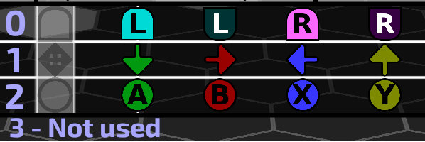

One Hand Tapping refers to a situation where a chart includes several notes in sequence on the same lane, for example:

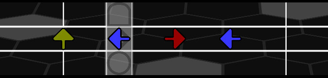

This forces the player to make multiple quick movements with the same hand, which is uncomfortable to play, especially on controller and on higher difficulties. To alleviate this, the above note sequence should instead be adjusted so that it alternates between note lanes, like this:

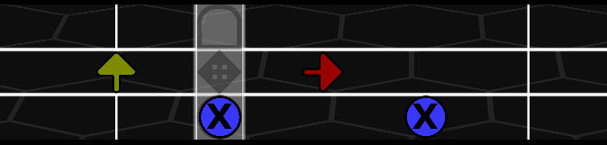

**NOTE: There are several exceptions to this rule. See the Exceptions section below.**

---

## 2-Lanes vs. 3-Lanes

When authoring charts, it is essential to keep in mind whether the chart uses *2 lanes* or *3 lanes*, as determined by the target difficulty. One Hand Tapping should be avoided regardless, but the methods available to avoid it differ slightly between 2-Lane and 3-Lane charts.

### 2-Lane Difficulties (Beginner, Medium, Mild, Hard)
On 2-Lane charts, only the Middle Lane (Directions) and Bottom Lane (Buttons) are used. Notes should typically alternate back and forth between the middle and bottom lanes. For example:

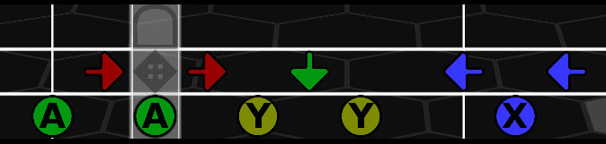

### 3-Lane Difficulties (Expert, N.E.R.F.)
On 3-Lane charts, the Top Lane (Triggers), Middle Lane (Directions) and Bottom Lane (Buttons) are all used. Notes should be placed on all three of these lanes, avoiding placing more than one consecutive note on the same lane. That said, the amount of notes on each lane don't have to be equal. For example:

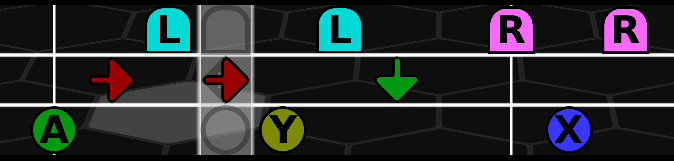

### Extra Difficulty
When charting an Extra difficulty chart, following the Official Charting Standard (OCS) is **completely optional**, meaning that One Hand Tapping rules can be ignored entirely. However, chart authors can still opt in to these rules if they wish. In such cases, the chart should follow either the 2-Lane or 3-Lane ruleset, depending on how many lanes the chart ends up using.

---

### Holds

[Todo]

All three of these examples are correct:

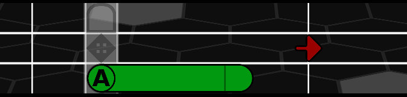  

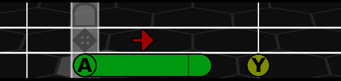  

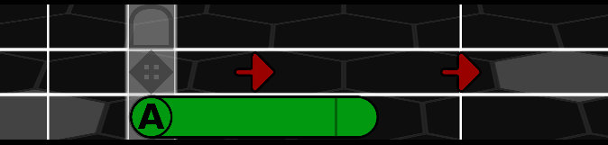  
*This last example uses One Hand Tapping. See the Exceptions section below.*

---

## Exceptions

While One Hand Tapping (consecutive *different* notes in the same lane) should generally be avoided when composing a standard chart, there are specific exceptions to this rule where single-lane patterns are acceptable or even encouraged:

### 1. One Button Tapping (Repeated Notes)

**One Button Tapping** refers to patterns where the **exact same note** is repeated multiple times in succession. For example:

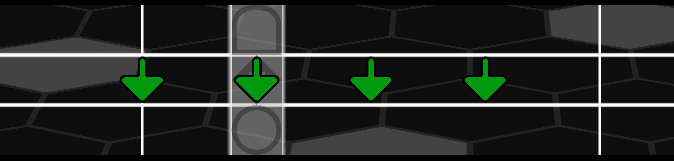

Unlike One Hand Tapping across multiple different buttons, repeating the same note does not require the player's thumb to reposition across the controller. The player can comfortably maintain their thumb on the exact same button and tap along with the rhythm. One Button Tapping is especially useful on lower difficulty levels such as Medium, which utilize a limited set of buttons. This allows for a greater variety of note patterns, while also being relatively simple for novice players to play.

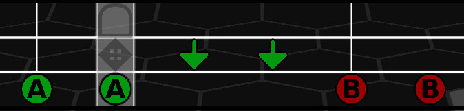

For higher difficulties, One Button Tapping works well and is recommended in cases where a song repeats the same musical note or percussion sound multiple times:

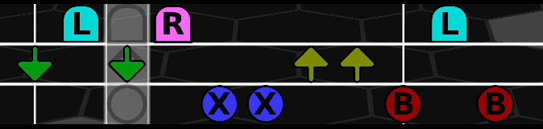

A good guideline is to have no more than four identical notes in a row. After the fourth note, switch to a different lane, regardless of how many times the same musical note is repeated:

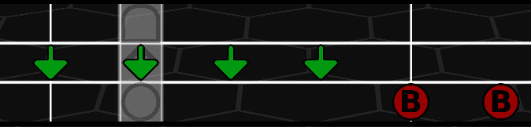

### 2. Double Notes

A *Double Note* occurs when two notes appear on different lanes at the exact same moment:

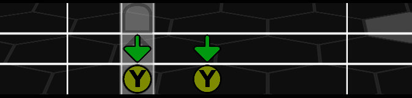

Handling the notes directly preceding and following a double note depends on whether the chart uses 2 lanes or 3 lanes:

#### In 2-Lane Charts

A double note occupies both available lanes simultaneously. Consequently, regardless of which lane is chosen for the note directly before or after the double note, it will inevitably share a lane with one of the notes in the double note pair, making a same-lane transition unavoidable. Because of this structural constraint in 2-lane charts, the note directly before and directly after a double note *can be placed on any lane*. On lower difficulty levels, using *One Button Tapping* in conjunction with the double note is recommended (though not required), to keep the pattern intuitive and minimize difficulty spikes.

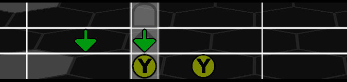

#### In 3-Lane Charts
Because three lanes are available and a double note only occupies two of them, a third lane is left free. The note preceding or following the double note should ideally be in the *lane that is not part of the double note* the adjacent notes should be placed in the Middle lane. Alternatively, consider using *One Hand Tapping* to alleviate difficulty spikes where it makes sense.

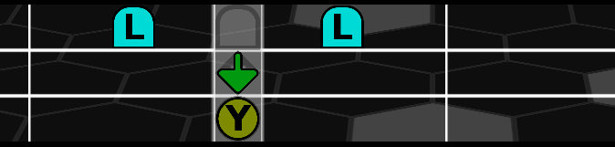  

### 3. Active Hold Notes (Held Lanes)

When a chart requires the player to sustain a **Hold Note** in one lane, the corresponding hand/finger is occupied holding down that input. Note placement rules during active holds depend on the chart's lane count:

#### In 2-Lane Charts:
When one lane is occupied by an active hold note, there is no room to place additional notes in that lane. Consequently, One Hand Tapping is acceptable on the remaining free lane. However, because one hand is pinned holding a button, notes charted on the free lane during the hold should have a lower note density to compensate for this.

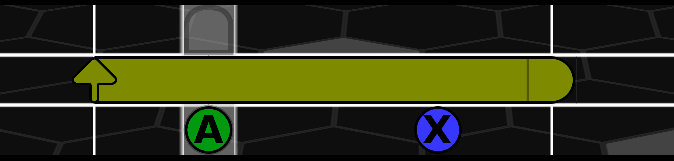

#### In 3-Lane Charts (Expert, N.E.R.F., 3-Lane Extra):
If only one lane is being held down, notes should alternate between the other two free lanes:

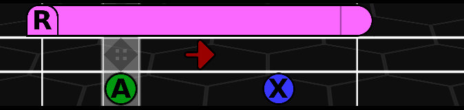

If two lanes are held down simultaneously, One Hand Tapping is acceptable on the single remaining free lane, while maintaining a lower, comfortable note density.

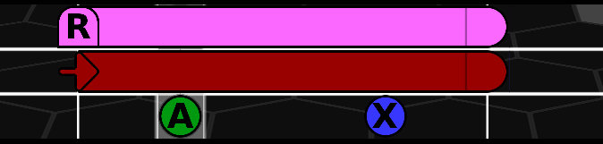

### 4. LB/LT/RB/RT notes

TODO