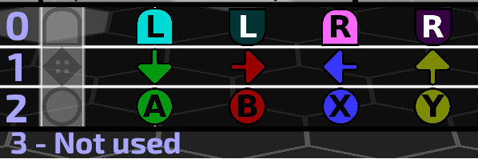
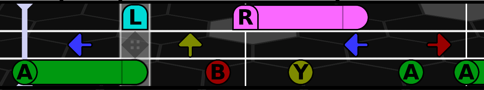

# SJSON File Format Guide

The **.sjson** (Song JSON) file format is used by Band BoomBox to store song metadata, audio timing information, section markers, and chart note data. Although `.sjson` uses a custom file extension, files are standard JSON documents. They can be read, created, edited, and validated using any standard JSON tool, library, or text editor. However, when creating custom songs, this is generally not necessary, as the Band BoomBox includes full song editing functionality.

---

## File Location and Naming

Each song in Band BoomBox resides in a folder within a configured `Songs` directory (such as `StreamingAssets/Songs/<author>/<song_name>/`). A typical song folder contains the following files for each song:

- **`<SongName>.sjson`**: The song data file containing chart and timing information.
- **`<AudioFile>.ogg`** (or `.wav` / `.mp3` /`.flac`): The audio track.
- **`<JacketArt>.png`** (or `.jpg`): Optional album artwork image.

---

## Root Structure (`SongData`)

At the root level, an `.sjson` file is a single JSON object with the following top-level properties:

```json
{
  "ID": "ec4a377a-5fce-4896-a9ba-8470ec9fc31b",
  "Version": 1,
  "Title": "Lightseeker",
  "Subtitle": "",
  "Artist": "thomeval",
  "ChartAuthor": "thomeval",
  "Issues": "",
  "Url": "",
  "AudioFile": "BoomBox-LightSeeker.ogg",
  "AlbumJacketArtFile": null,
  "Bpm": 120.0,
  "AudioStart": 8.2,
  "Offset": 16.2,
  "Length": 177.46,
  "BeatsPerMeasure": 4,
  "Sections": {
    "0": "Verse 1a",
    "32": "Verse 1b",
    "64": "Break",
    "96": "Verse 2a"
  },
  "SongCharts": [ ... ]
}
```

### Basic Information

| Field | Type | Description |
|---|---|---|
| `ID` | string | A unique identifier (UUID/GUID string) for the song. Automatically set by the Song Editor when a song is first created. |
| `Version` | integer | The version of the song. Increment this to reset individual and team high scores if the song receives significant changes later on.|
| `Title` | string | The display title of the song (e.g., `"Lightseeker"`). |
| `Subtitle` | string | Optional subtitle or remix detail (e.g., `"Band Version"` or `""`). |
| `Artist` | string | Name of the song's musical artist/creator (e.g., `"thomeval"`). |
| `ChartAuthor` | string | Name of the chart creator who mapped the note notes for Band BoomBox. |
| `Issues` | string | Optional notes regarding chart/audio issues or maintainer comments. |
| `Url` | string | Optional URL link to the artist or song source page. |

### Audio and Timing Properties

| Field | Type | Description |
|---|---|---|
| `AudioFile` | string | Filename of the audio file relative to the song folder (e.g., `"BoomBox-LightSeeker.ogg"`). |
| `AlbumJacketArtFile` | string / null | Optional filename of jacket artwork image (e.g., `"cover.png"` or `null`). |
| `Bpm` | float | Beats Per Minute (BPM) of the song track (e.g., `120.0`). |
| `AudioStart` | float | Timestamp in seconds when audio playback starts during gameplay. This should be set to a couple of seconds before the `Offset`. |
| `Offset` | float | Time offset in seconds before Beat 0 of the chart (the first playable beat of the song) begins. |
| `Length` | float | Time offset in seconds where the playable segment of the song ends.  |
| `BeatsPerMeasure` | integer | Time signature numerator; beats per bar/measure (defaults to `4`). |

### Sections

`Sections` is a JSON object mapping beat positions (as numeric strings) to section names. These section names are displayed in-game during gameplay, as well as in the Chart Editor. See ![Official Charting Standard] for more details on adding Sections.

Example from *Lightseeker*:
```json
"Sections": {
  "0": "Verse 1a",
  "32": "Verse 1b",
  "64": "Break",
  "96": "Verse 2a",
  "128": "Verse 2b",
  "160": "Bridge 1a",
  "192": "Bridge 1b",
  "224": "Verse 3a",
  "256": "Verse 3b",
  "288": "Verse 3c"
}
```

---

## Song Charts (`SongChart`)

The `SongCharts` array contains one or more chart objects each representing a single playable chart. Songs will typically feature several of these (one for Beginner, one for Medium, one for Mild etc).

```json
{
  "Group": "Primary",
  "Difficulty": 0,
  "DifficultyLevel": 1,
  "NoteCounts": {
    "TapNotes": 51,
    "HoldNotes": 56,
    "AverageNps": 1.01079,
    "MaxNps": 1.25,
    "TrimmedAverageNps": 1.00833333,
    "LaneNotes": [ 0, 83, 80, 0 ],
    "TotalNotes": 163
  },
  "Notes": [
    "0200",
    "0000",
    "0G00",
    "0000"
  ]
}
```

### Chart Metadata Fields

| Field | Type | Description |
|---|---|---|
| `Group` | string | Group name, used to differentiate songs that have more than one chart for the same `Difficulty`. Default is `Main`. |
| `Difficulty` | integer | Integer enum representing the difficulty mode (see table below). |
| `DifficultyLevel` | integer | Numeric difficulty rating displayed in the Song Select Screen and Difficulty Select Screen. Typically ranges from 1 to 18. |
| `NoteCounts` | object | Precalculated chart metrics (see section below). |
| `Notes` | array of strings | Array of encoded note blocks, indexed by beat number. |

> Multiple charts with the same difficulty are allowed, but they must have a different group set.

### Difficulty Enum Reference

| ID | Difficulty Name |
|---|---|
| `0` | Beginner | 
| `1` | Medium |
| `2` | Hard |
| `3` | Expert |
| `4` | N.E.R.F. |
| `5` | Mild |
| `10` | Extra |

### Note Counts (`SongChartNoteCounts`)

The `NoteCounts` object holds calculated statistics for the chart:

- `TapNotes` (integer): Total number of tap notes.
- `HoldNotes` (integer): Total number of hold notes.
- `AverageNps` (float): Average notes per second across the entire chart.
- `MaxNps` (float): Peak notes per second.
- `TrimmedAverageNps` (float): Average notes per second excluding silent or empty chart sections. Note that the `Average NPS` display on the Difficulty Select screen uses this value.
- `LaneNotes` (array of 4 integers): Number of notes in each lane `[Lane 0, Lane 1, Lane 2, Lane 3]`. The fourth value is currently unused.
- `TotalNotes` (integer): Sum of notes across all lanes, calculated as `TapNotes` + `HoldNotes` + `ReleaseNotes`.

---

## Note Data Format (`Notes`)

The `Notes` property in a `SongChart` is an array of strings where each element index corresponds to an integer beat number:

```json
[`beat 0`, 
 `beat 1`, 
  beat 2`,
   ...]
```

### Beat Subdivisions and Blocks

Each element in `Notes` is subdivided into or more 4-character *blocks*. Each one of these blocks represents a specific point within that beat. If the same beat contains multiple note events or sub-beat notes (e.g., eighth notes, sixteenth notes, triplets), multiple 4-character blocks are appended in the string (separated by spaces):

- **1 block** (4 characters, e.g. `"0200"`): Whole beat step (step size = `1.0`). Note occurs at beat `x.0`.
- **2 blocks** (8 characters, e.g. `"0100 0010"`): Half beat step (step size = `0.5`). Notes occur at beats `x.0` and `x.5`.
- **3 blocks** (12 characters): Triplet step (step size = `1/3`). Notes occur at `x.0`, `x.333`, `x.666`.
- **4 blocks** (16 characters): Quarter beat / 16th note step (step size = `0.25`). Notes occur at `x.0`, `x.25`, `x.50`, `x.75`.

Supported subdivision block counts per beat are: `1, 2, 3, 4, 6, 8, 12, 24`.

---

## Lane Layout and Note Encoding

Each individual block consists of 4 characters, one for each lane: 



- Lane 0: Triggers / Shoulder controls (`LB`, `LT`, `RB`, `RT`, or `AnyT`).
- Lane 1: Directional D-Pad controls (`Left`, `Down`, `Up`, `Right`, or `AnyD`).
- Lane 2: Action / Face Button controls (`A`, `B`, `X`, `Y`, or `AnyB`).
- Lane 3: Currently reserved / unused (typically `'0'`).

### Character Encoding Reference

Each character within a block specifies both the *Note Type* (which specific button/input) and the *Note Class* (Tap, Hold Start, or Hold Release):

| Character | Lane 0 (Triggers) | Lane 1 (Directions) | Lane 2 (Buttons) | Note Class |
|:---:|---|---|---|---|
| `'0'` | *(None)* | *(None)* | *(None)* | Empty |
| `'1'` | Any Trigger (`AnyT`) | Any Direction (`AnyD`) | Any Button (`AnyB`) | Tap |
| `'2'` | Any Trigger (`AnyT`) | Any Direction (`AnyD`) | Any Button (`AnyB`) | Hold Start |
| `'4'` | `LB` | `Left` | `X` | Tap |
| `'5'` | `LB` | `Left` | `X` | Hold Start |
| `'7'` | `LT` | `Down` | `A` | Tap |
| `'8'` | `LT` | `Down` | `A` | Hold Start |
| `'A'` | `RB` | `Up` | `Y` | Tap |
| `'B'` | `RB` | `Up` | `Y` | Hold Start |
| `'D'` | `RT` | `Right` | `B` | Tap |
| `'E'` | `RT` | `Right` | `B` | Hold Start |
| `'G'` | Release | Release | Release | Release (Hold End) |

> **NOTE:** Hold notes consist of a Hold Start character (`'2'`, `'5'`, `'8'`, `'B'`, or `'E'`) at the starting beat position, followed by a Release character (`'G'`) at the beat position where the hold finishes. The game will automatically convert the Release character to the appropriate Note Type when loading the chart.

---

## Example Note Sequence Walkthrough

Consider the opening 8 beats of the Primary Expert chart (`"Difficulty": 3`) from *Lightseeker.sjson*:

```json
"Notes": [
  "0080",
  "0400",
  "40G0",
  "0A00 00D0",
  "B000",
  "00A0",
  "G400",
  "0070 0D00",
  "0080"
]
```



Step-by-step breakdown:

1. **Beat 0 (`"0080"`)**:
   - Lane 2 (Action Buttons) has character `'8'` (`A` Button Hold Start).
   - An `A` button hold note begins at beat 0.0.
2. **Beat 1 (`"0400"`)**:
   - Lane 1 (Directions) has character `'4'` (`Left` D-Pad Tap).
   - A `Left` D-Pad tap note occurs at beat 1.0 while the `A` hold note in Lane 2 continues.
3. **Beat 2 (`"40G0"`)**:
   - Lane 0 (Triggers) has character `'4'` (`LB` Shoulder Trigger Tap).
   - Lane 2 (Action Buttons) has character `'G'` (Release).
   - An `LB` trigger tap note occurs at beat 2.0 while the `A` hold note in Lane 2 ends.
4. **Beat 3 (`"0A00 00D0"`)**:
   - Contains two 4-character blocks, dividing the beat into half beats (`0.5` step size).
   - At beat 3.0 (`"0A00"`): Lane 1 has character `'A'` (`Up` D-Pad Tap).
   - At beat 3.5 (`"00D0"`): Lane 2 has character `'D'` (`B` Button Tap).
5. **Beat 4 (`"B000"`)**:
   - Lane 0 (Triggers) has character `'B'` (`RB` Shoulder Trigger Hold Start).
   - An `RB` trigger hold note begins at beat 4.0.
6. **Beat 5 (`"00A0"`)**:
   - Lane 2 (Action Buttons) has character `'A'` (`Y` Button Tap).
   - A `Y` button tap note occurs at beat 5.0 while the `RB` hold note in Lane 0 continues.
7. **Beat 6 (`"G400"`)**:
   - Lane 0 (Triggers) has character `'G'` (Release).
   - Lane 1 (Directions) has character `'4'` (`Left` D-Pad Tap).
   - A `Left` D-Pad tap note occurs at beat 6.0 while the `RB` hold note in Lane 0 ends.
8. **Beat 7 (`"0070 0D00"`)**:
   - Contains two 4-character blocks (half-beat division).
   - At beat 7.0 (`"0070"`): Lane 2 has character `'7'` (`A` Button Tap).
   - At beat 7.5 (`"00D0"`): Lane 1 has character `'D'` (`Right` D-Pad Tap).
9. **Beat 8 (`"0080"`)**:
   - Lane 2 (Action Buttons) has character `'8'` (`A` Button Hold Start).
   - An `A` button hold note begins at beat 8.0.

---
